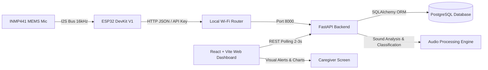

# Smart Baby Monitoring System — Architecture & Implementation Plan

## 1. System Overview

The **Smart Baby Monitoring System** is an end-to-end IoT and Full-Stack web application designed as an MCA college project. It provides non-invasive, continuous acoustic monitoring of an infant's room without video surveillance, prioritizing family privacy and local network security.

> **Important Disclaimer:** This application is an assistive prototype for caregivers. It is **not** a medical device, does not diagnose medical conditions, and does not determine the psychological or physiological cause of crying. Caregiver supervision is always required.

---

## 2. Hardware Specification & Pin Mapping

### Confirmed Components
- **Microcontroller**: ESP32 DevKit V1 (30-pin / 38-pin compatible)
- **Acoustic Sensor**: INMP441 Omnidirectional Digital I²S MEMS Microphone
- **Power & Data**: Micro-USB Cable to Windows Development Host / 5V USB Wall Adapter
- **Interconnect**: Solderless Breadboard & Female-to-Female / Male-to-Female Jumper Wires

### Wiring Configuration
| INMP441 Pin | ESP32 DevKit V1 Pin | Function / Description |
| :--- | :--- | :--- |
| **VDD** | **3V3** | **Power: 3.3V ONLY** (Connecting 5V permanently destroys INMP441) |
| **GND** | **GND** | Common Ground |
| **SD** | **GPIO 33** | Serial Data (I²S Data Input) |
| **WS** | **GPIO 25** | Word Select / Left-Right Clock |
| **SCK** | **GPIO 26** | Serial Clock / Bit Clock |
| **L/R** | **GND** | Left/Right Channel Select (Tied to GND selects Left Channel) |

*Optional Future Sensor*: DHT11 (Data -> GPIO 4, VCC -> 3V3, GND -> GND). Kept optional and modular.

---

## 3. Technology Stack

- **Firmware**: Arduino C++ with ESP32 Arduino Core 3.3.12 (`driver/i2s.h` compatible)
- **Local Network**: HTTP/1.1 REST with JSON payloads over local Wi-Fi 802.11 b/g/n (2.4 GHz)
- **Backend API**: Python 3.14 / FastAPI with asynchronous request handlers
- **Data Persistence**: PostgreSQL 18 (with SQLite local fallback for isolated unit testing)
- **ORM & Migrations**: SQLAlchemy 2.0 with Alembic
- **Frontend Dashboard**: React 18 / Vite with Tailwind CSS and Recharts
- **Audio Processing**: NumPy and SciPy for feature extraction (RMS, peak amplitude, spectral energy)

---

## 4. Database Schema

### 1. `devices`
Tracks registered ESP32 monitoring devices and their connectivity health:
- `id` (UUID / Integer, Primary Key)
- `device_id` (VARCHAR(64), Unique, Indexed) e.g., `"esp32-nursery-01"`
- `device_name` (VARCHAR(128))
- `created_at` (TIMESTAMP WITH TIME ZONE)
- `last_seen_at` (TIMESTAMP WITH TIME ZONE)
- `connection_status` (VARCHAR(20)) — `ONLINE`, `OFFLINE`, `STALE`

### 2. `sensor_readings`
Time-series of acoustic features transmitted by the ESP32:
- `id` (BIGINT, Primary Key)
- `device_id` (VARCHAR(64), Foreign Key -> `devices.device_id`, Indexed)
- `sound_level` (FLOAT) — Calculated sound level in decibels (dB)
- `rms_amplitude` (FLOAT) — Root Mean Square energy
- `peak_amplitude` (INTEGER) — Maximum absolute sample value in block
- `recorded_at` (TIMESTAMP WITH TIME ZONE, Indexed)
- `received_at` (TIMESTAMP WITH TIME ZONE, Default NOW())

### 3. `crying_events`
High-level event records created when acoustic conditions or classification trigger alerts:
- `id` (BIGINT, Primary Key)
- `device_id` (VARCHAR(64), Foreign Key -> `devices.device_id`, Indexed)
- `start_time` (TIMESTAMP WITH TIME ZONE)
- `end_time` (TIMESTAMP WITH TIME ZONE, Nullable while event active)
- `duration_seconds` (FLOAT, Default 0.0)
- `classification` (VARCHAR(50)) — `POSSIBLE_CRYING`, `HIGH_NOISE`, `UNCERTAIN`
- `confidence` (FLOAT) — 0.0 to 1.0 confidence score
- `acknowledged` (BOOLEAN, Default FALSE)
- `created_at` (TIMESTAMP WITH TIME ZONE)

### 4. `room_environment` (Optional DHT11 Module)
- `id` (BIGINT, Primary Key)
- `device_id` (VARCHAR(64), Foreign Key)
- `temperature` (FLOAT) — Celsius
- `humidity` (FLOAT) — Percentage
- `recorded_at` (TIMESTAMP WITH TIME ZONE)

---

## 5. Distinction: Sound-Level vs. Audio Classification

1. **Acoustic Energy (Sound-Level / RMS)**:
   - Indicates *loudness*. An open door, traffic horn, television, or dog bark will elevate sound level.
   - It **cannot** definitively tell if the sound is a crying infant.
2. **Crying Classification**:
   - Analyzes temporal patterns, harmonic pitch frequencies (typical baby cry fundamental frequency $F_0$ lies in the 400–600 Hz range with repetitive expiratory cries and pauses).
   - The application will clearly differentiate states on the dashboard:
     - 🟢 **Quiet**: Baseline background noise (< 45 dB).
     - 🟡 **Sound Activity Detected**: Elevated noise (>= 50 dB), non-crying or unclassified.
     - 🔴 **Possible Crying Detected**: Harmonic cry signature verified by classifier or cry detector rule with sustained duration.
     - ⚪ **Device Offline**: No heartbeat received in the last 15 seconds.

---

## 6. Implementation Phases

| Phase | Title | Scope & Deliverables |
| :---: | :--- | :--- |
| **Phase 1** | **Workspace Setup & Plan** | Project structure, baseline INMP441 sketch reference, environment templates, architecture plan. *(Current)* |
| **Phase 2** | **FastAPI Backend & Database** | FastAPI application, PostgreSQL database setup, SQLAlchemy models, schemas, ingestion & query endpoints, unit tests. |
| **Phase 3** | **React Frontend Dashboard** | Vite + React + Tailwind + Recharts UI, status indicators, live telemetry polling, event log, visual alert banner. |
| **Phase 4** | **ESP32 Firmware Integration** | Complete Arduino sketch with Wi-Fi auto-reconnect, I2S capture, feature calculation, HTTP POST ingestion with API key. |
| **Phase 5** | **Audio Processing & Classification** | Acoustic feature extraction (frequency analysis / ML crying detector pipeline), event debouncing, confidence rating. |
| **Phase 6** | **Optional DHT11 Integration** | Modular support for temperature/humidity without altering microphone stability. |
| **Phase 7** | **End-to-End Testing & Docs** | Hardware verification, mock data simulator, college project report outline, presentation checklist. |
