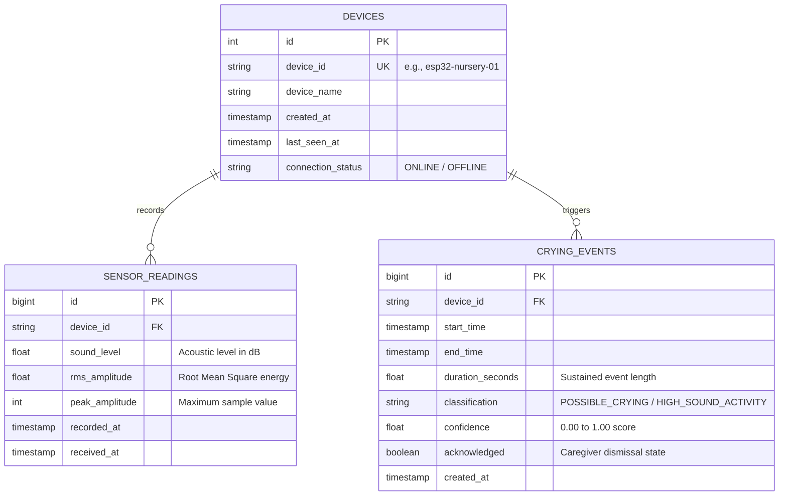

# Smart Baby Monitoring System — College Project Report & Demonstration Guide

**Project Title:** Smart Baby Monitoring System (IoT + Full-Stack Web Application)  
**Course:** Master of Computer Applications (MCA) Major Project  
**Domain:** Internet of Things (IoT), Acoustic Signal Processing, Full-Stack Web Engineering  

---

## 1. System Architecture & Data Flow

```mermaid
flowchart TD
    subgraph Nursery ["Infant Room (IoT Acoustic Node)"]
        MIC["INMP441 MEMS Microphone"] -->|I2S Bus (SCK:26, WS:25, SD:33)| ESP["ESP32 DevKit V1"]
        ESP -->|DMA 16 kHz Audio Buffer| FEAT["Feature Extraction (RMS, Peak, dB)"]
    end

    subgraph Network ["Local Wi-Fi Network (No Cloud Required)"]
        FEAT -->|HTTP POST with X-API-Key| ROUTER["Local 2.4 GHz Wi-Fi Router"]
        ROUTER -->|Port 8000 (192.168.60.178)| API["FastAPI Backend Server"]
    end

    subgraph Processing ["Computer / Host Backend"]
        API -->|SQLAlchemy 2.0 ORM| DB[(PostgreSQL 18 Database)]
        API -->|Spectral & Pitch Analysis| CLASSIFIER["Acoustic Crying Classifier"]
        CLASSIFIER -->|Debouncing & Event Creation| DB
    end

    subgraph Caregiver ["Caregiver Monitoring Station"]
        DASH["React 19 + Vite + Tailwind Dashboard"] -->|REST Polling (2.5s)| API
        DASH -->|Recharts Line Graph| GRAPH["Live dB Telemetry Curve"]
        DASH -->|Visual Alert Notification| ALERT["Caregiver Alert & Dismissal"]
    end
```

---

## 2. Hardware Specification & Wiring Table

| Component | Function | Model / Spec |
| :--- | :--- | :--- |
| **Microcontroller** | IoT Edge Processing & Wi-Fi Node | ESP32 DevKit V1 (30-pin, Xtensa Dual-Core 240MHz) |
| **Acoustic Sensor** | Digital MEMS Omnidirectional Microphone | INMP441 (I²S digital output, 61 dBA SNR) |
| **Interconnects** | Jumper Wires & Breadboard | Female-to-Female / Male-to-Female |
| **Power Source** | 5V USB Bus Power | Micro-USB Data Cable |

### Strict GPIO Pinout (DO NOT CHANGE)
| INMP441 Pin | ESP32 DevKit Pin | Technical Rationale |
| :--- | :--- | :--- |
| **VDD** | **3V3** | **CRITICAL:** INMP441 is a 3.3V sensor. 5V destroys the chip. |
| **GND** | **GND** | Common reference ground |
| **SD** | **GPIO 33** | I²S Serial Data Input (Connected to DMA Channel 0) |
| **WS** | **GPIO 25** | Word Select / Left-Right Clock |
| **SCK** | **GPIO 26** | Serial Clock / Bit Clock |
| **L/R** | **GND** | Left/Right Channel Select (Tied to GND = Left Channel) |

---

## 3. Database Entity-Relationship (ER) Diagram



---

## 4. Complete Backend API Specification

| Method | Endpoint | Description | Auth Required |
| :--- | :--- | :--- | :---: |
| `GET` | `/` | API status and Swagger documentation link | No |
| `GET` | `/health` | Server and PostgreSQL health check | No |
| `POST` | `/api/readings` | Ingests ESP32 sound telemetry (dB, RMS, Peak) | `X-API-Key` |
| `GET` | `/api/readings/latest`| Retrieves latest sensor packet | No |
| `GET` | `/api/readings` | Paginated historical telemetry | No |
| `POST` | `/api/audio/classify` | Ingests WAV chunk for pitch and FFT classification | `X-API-Key` |
| `GET` | `/api/events` | List detected crying and high-noise events | No |
| `PATCH`| `/api/events/{id}/acknowledge`| Caregiver dismisses an active alert | No |
| `GET` | `/api/stats` | Aggregated metrics for dashboard cards | No |
| `GET` | `/api/devices` | Registered device list and heartbeat status | No |

---

## 5. Acoustic Classification Science (Viva Defense Notes)

### Why Ordinary Sound-Level (dB) is Not Enough
An ordinary sound-level switch or baby monitor buzzes whenever a door closes, television dialogue spikes, or someone talks in the hallway. This causes alert fatigue.

### The Scientific Crying Signature
1. **Fundamental Pitch ($F_0$):** Infant vocal cords produce acoustic resonance in the **350 Hz to 680 Hz** range (averaging ~480 Hz). Adult speech is much lower (85 Hz–255 Hz).
2. **Harmonic Periodicity:** Infant crying is voiced phonation with high periodicity ($>0.30$), unlike unvoiced noise clicks or wind.
3. **Spectral Distribution:** The majority of acoustic energy ($>40\%$) is concentrated between **350 Hz and 2500 Hz**.
4. **State Machine:**
   - 🟢 **`QUIET`**: Ambient nursery background sound ($< 45\text{ dB}$).
   - 🟡 **`HIGH_SOUND_ACTIVITY`**: Elevated noise ($\ge 65\text{ dB}$) with non-cry spectral features (e.g., slamming door, adult shouting, TV).
   - 🔴 **`POSSIBLE_CRYING`**: Sustained sound ($\ge 55\text{ dB}$) with $F_0 \in [350, 680\text{ Hz}]$, high periodicity, and cry-band spectral concentration.

---

## 6. Step-by-Step Demonstration Procedure

### Demonstration Checklist
- [ ] **Step 1: Start PostgreSQL Service**
  Ensure the `postgresql-x64-18` service is running in Windows Services.
- [ ] **Step 2: Start FastAPI Backend**
  ```powershell
  cd E:\Baby_Monitoring_System
  .\backend\.venv\Scripts\uvicorn app.main:app --app-dir backend --host 0.0.0.0 --port 8000 --reload
  ```
  Open `http://localhost:8000/docs` in your browser to show the examiner interactive Swagger API docs.
- [ ] **Step 3: Start React Dashboard**
  ```powershell
  cd E:\Baby_Monitoring_System\frontend
  npm run dev
  ```
  Open `http://localhost:5173` to display the live dashboard.
- [ ] **Step 4: Power On ESP32 Node**
  Plug in the ESP32 to USB. Open Arduino IDE Serial Monitor at 115200 baud.
  Verify Wi-Fi connection and HTTP 201 telemetry prints.
- [ ] **Step 5: Test Quiet Room State**
  Show the examiner that when the room is silent, the dashboard displays:
  - 🟢 **Quiet Nursery**
  - Sound levels around 35–42 dB.
  - Telemetry curve resting at the bottom of the graph.
- [ ] **Step 6: Test Sudden Loud Noise (Non-Crying)**
  Clap hands or drop a book.
  Show that the status changes to 🟡 **High Sound Activity**, demonstrating that the system does **not** falsely label every loud sound as a crying baby.
- [ ] **Step 7: Test Possible Crying Detection**
  Play an infant cry recording or run the simulator.
  Show that:
  - The status turns 🔴 **Possible Crying Detected**.
  - A red visual alert banner pulses at the top with event duration.
  - Clicking **Acknowledge Alert** updates the database and marks the alert as dismissed.
- [ ] **Step 8: Test Device Disconnection / Recovery**
  Unplug the ESP32.
  Within 15 seconds, the dashboard turns ⚪ **Device Offline**, demonstrating active heartbeat monitoring.
  Plug the ESP32 back in; the dashboard automatically recovers to 🟢 **Online**.

---

## 7. Troubleshooting Matrix

| Issue | Root Cause | Solution |
| :--- | :--- | :--- |
| **ESP32 Serial prints `[HTTP FAILED]`** | Windows Defender Firewall blocking port 8000 | Run PowerShell as Admin: `New-NetFirewallRule -DisplayName "Baby Monitor 8000" -Direction Inbound -LocalPort 8000 -Protocol TCP -Action Allow` |
| **ESP32 cannot connect to Wi-Fi** | Network is 5 GHz only or credentials wrong | Ensure Wi-Fi is 2.4 GHz (ESP32 does not support 5 GHz Wi-Fi) and check SSID/password in lines 38-39 of the sketch. |
| **INMP441 reads 0.0 dB constantly** | Miswired SCK, WS, or SD pins | Verify GPIO 26 (SCK), GPIO 25 (WS), and GPIO 33 (SD). Ensure L/R is connected to GND. |
| **`localhost` connection refused on ESP32** | Using `localhost` instead of local IPv4 | On ESP32, use computer IP `http://192.168.60.178:8000/api/readings`. |
| **Database error on startup** | PostgreSQL service stopped | Open Windows Services (`services.msc`), find `postgresql-x64-18`, and click Start. |

---

## 8. MCA Project Report Chapter Outline

1. **Chapter 1: Introduction**
   - 1.1 Background & Motivation (Infant Care in Modern Nuclear Families)
   - 1.2 Problem Statement (Flaws of traditional video monitors and simple decibel buzzers)
   - 1.3 Project Objectives (Non-invasive acoustic monitoring, local privacy, cloud independence)
   - 1.4 Scope and Limitations
2. **Chapter 2: Literature Survey**
   - 2.1 Acoustic Analysis of Infant Cry Signals
   - 2.2 Comparison of IoT Microcontroller Platforms (ESP32 vs. Arduino Uno vs. Raspberry Pi)
   - 2.3 MEMS vs. Analog Microphones in Acoustic Telemetry
3. **Chapter 3: System Requirements & Architecture**
   - 3.1 Hardware Requirements (ESP32 DevKit V1, INMP441 MEMS Microphone)
   - 3.2 Software Requirements (Python FastAPI, PostgreSQL, React, Vite, Tailwind CSS)
   - 3.3 System Data Flow Architecture
   - 3.4 Database Schema Design & Normalization
4. **Chapter 4: Implementation**
   - 4.1 ESP32 I²S Audio Acquisition and Non-Blocking Wi-Fi Transmission
   - 4.2 FastAPI REST Backend and Security Key Authentication
   - 4.3 Acoustic Feature Extraction ($F_0$ Autocorrelation, ZCR, FFT Cry-Band Ratio)
   - 4.4 React Caregiver Dashboard, Recharts Telemetry Graph, and Alert Management
5. **Chapter 5: Testing and Results**
   - 5.1 Automated Unit & Integration Testing (Pytest Suite, 17 test cases)
   - 5.2 Controlled Acoustic Tests (Quiet baseline, ambient household noise, infant cry samples)
   - 5.3 Network Latency and Heartbeat Disconnection Recovery Analysis
6. **Chapter 6: Conclusion and Future Enhancements**
   - 6.1 Project Summary
   - 6.2 Future Enhancements (On-device TinyML inference on ESP32-S3, mobile push notifications)
7. **References & Appendices**
   - Source Code Listings, Pinout Diagrams, and OpenAPI Schemas.
